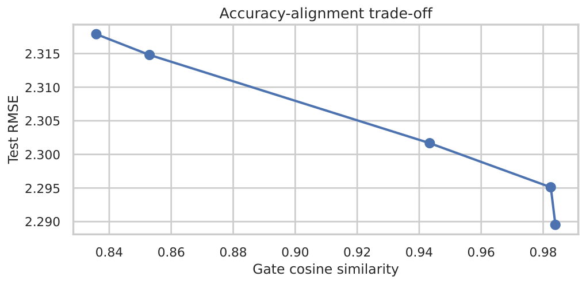
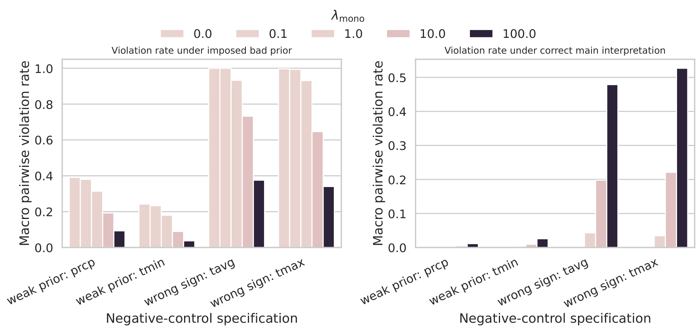

# Interpretability-driven regularization for station-level weather forecasting

Code, data and results for my M.Sc. (Tech.) thesis at Aalto University (2026, Machine Learning, Data Science and Artificial Intelligence; supervisor Prof. Alex Jung):
*Interpretability-Driven Regularization for Station-Level Weather Forecasting: User Pseudo-Labels for Feature Importance and Monotonicity*. Full text: [`docs/thesis.pdf`](docs/thesis.pdf), also in [Aaltodoc](https://aaltodoc.aalto.fi/items/31c8e057-7f71-4776-978c-8d7ae27e0bf3).

## Main finding

A model can be trained to **look** like it follows a user's feature-importance prior without actually **using** features that way. When the prior is deliberately wrong (a randomly permuted expert prior), the learned input gate still matches it almost perfectly (gate cosine 0.98, the same as for the correct prior). But function-level checks (occlusion and SHAP) show that the model's actual feature use matches the wrong prior much less (occlusion cosine 0.56 vs 0.73 for the correct prior). Parameter-level alignment with a prior is therefore not evidence that a model follows it; behavioural checks and deliberately wrong priors as negative controls are needed.

## The idea

Interpretability is usually checked *after* training. This project builds a user's interpretability priors **into the training objective** and then tests whether the model really follows them:

- **Feature importance:** a learnable input gate `g = sigmoid(alpha)` scales each feature, and a penalty pulls the gate towards a user-given pseudo-label vector `z` ("temperature matters a lot, a random noise feature not at all").
- **Monotonicity:** hinge penalties on local pairs of similar days enforce, for example, "a warmer day today should not lower tomorrow's forecast".

The full objective is task loss (MSE) + `lambda_feat` × feature-importance penalty + `lambda_mono` × monotonicity penalty.

**Task and scope:** predict next-day maximum temperature at a single Finnish Meteorological Institute station (Espoo Nuuksio) from same-day observations (min, mean and max temperature, precipitation) and cyclical day-of-year features, plus an injected random-noise feature as a control. Daily data 2016–2025 (about 3,650 days), chronological 70/15/15 train/validation/test split. Model: a small PyTorch MLP trained with MSE. The aim is a controlled testbed for the regularizers, not a state-of-the-art forecast.

## Results

Numbers below come from the files in `results/`; sweeps are means over 5 seeds. See [Note on numbers](#note-on-numbers) for how they relate to the thesis tables.

Benchmarks on the test set (`notebooks/03_baseline_training.ipynb`, `results/baseline/`):

| Predictor | Test RMSE (°C) |
| --- | --- |
| Persistence (tomorrow = today) | 2.64 |
| Linear regression | 2.31 |
| MLP baseline | 2.30 |

The task has real signal beyond persistence but is close to linear with these features.

**RQ1, feature importance** (`results/feature_importance_basic/`). Increasing `lambda_feat` from 0 to 1000 raises gate–prior cosine similarity from 0.84 to 0.98 while test RMSE moves from 2.32 to 2.29 °C. The permuted-prior comparison in the main finding (at `lambda_feat` = 100, mean over 6 permutations) shows that this gate alignment alone does not prove function-level feature use.



**RQ2, monotonicity** (`results/monotonicity_training/`). The unregularized model already violates the chosen monotonicity constraints in about 0.15% of test pairs, so the main effect is small. Negative controls show that the regularizer is active: with a wrong-sign prior, stronger regularization makes the model follow the wrong prior, and test RMSE rises from 2.32 to 3.57 °C (`t_avg`) and 3.70 °C (`t_max`) at `lambda_mono` = 100.



**RQ3, combined** (`results/combined_regularization/`). Both priors can be tuned largely independently in one model: `lambda_feat` mainly moves gate alignment, `lambda_mono` mainly moves monotonicity diagnostics, at a small predictive cost.

### Note on numbers

The `results/` folder and the figures come from the final run of the code. Some tables in the thesis PDF come from an earlier run of the same experiments, so a few values differ in the second or third decimal (for example MLP baseline test RMSE 2.30 here vs 2.31 in the thesis, and gate cosine at `lambda_feat` = 1000 of 0.98 vs 0.97). The conclusions are the same in both runs.

## Repository layout

| Path | Contents |
| --- | --- |
| `src/` | Data loading and cleaning, models (MLP, gated MLP), training loop with both regularizers, monotonicity pair construction, alignment metrics (gate, occlusion, SHAP) |
| `notebooks/` | Experiments in thesis order: exploration (01), dataset build (02), baseline and benchmarks (03), feature-importance sweeps (05, 06), monotonicity pair audit (07), monotonicity training (08), combined regularization (10) |
| `data/` | FMI daily observations for Espoo Nuuksio, raw and cleaned; see [data/README.md](data/README.md) |
| `results/` | Saved configs, metrics, sweep summaries, monotonicity pair sets and selected model checkpoints |
| `docs/` | Thesis PDF and figures |

**Where to start:** `notebooks/06_feature_importance_z_sweep.ipynb` holds the main finding (expert vs permuted priors). Notebooks 08 and 10 use the monotonicity pair sets that notebook 07 saves in `results/monotonicity_audit/`.

## Running

Python 3.10+.

```bash
pip install torch            # see pytorch.org for the right build for your GPU/CPU
pip install -r requirements.txt   # or requirements-tested.txt for the exact tested versions
pip install -e .
jupyter lab notebooks/
```

The notebooks read from `data/` and write to `results/` and `docs/figures/`. Notebooks 05, 06 and 10 load cached runs and saved models from `results/` (`RUN_TRAINING = False`), so the figures can be reproduced without retraining. The dataset is small, so training on a CPU is feasible.

Tested on 2026-11-20 from a fresh copy on CPU (Python 3.12, PyTorch 2.15, pandas 3.1, scikit-learn 1.9, SHAP 0.54): notebooks 01, 03, 05, 06 and 10 run without errors, and the cached results reproduce. Retraining gives slightly different numbers depending on hardware and library versions (MLP baseline test RMSE 2.310 on CPU vs 2.304 in `results/baseline/`).

## Licences

- **Code** (`src/`, code in the notebooks, configuration files): MIT, see [LICENSE](LICENSE).
- **Thesis** (`docs/thesis.pdf`) **and figures** (`docs/figures/`): © 2026 Alexander von Hertzen, [CC BY-NC-SA 4.0](https://creativecommons.org/licenses/by-nc-sa/4.0/).
- **Weather data** (`data/`): Finnish Meteorological Institute, [CC BY 4.0](https://creativecommons.org/licenses/by/4.0/); attribution and changes in [data/README.md](data/README.md).

## Contact

Alexander von Hertzen · [LinkedIn](https://www.linkedin.com/in/alexandervonhertzen/)
